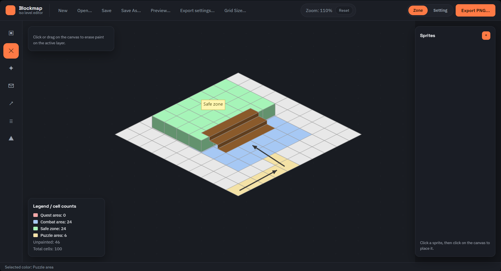
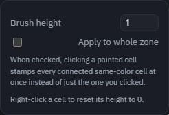
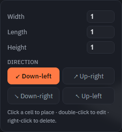
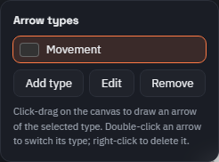
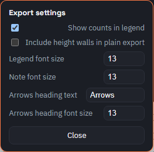
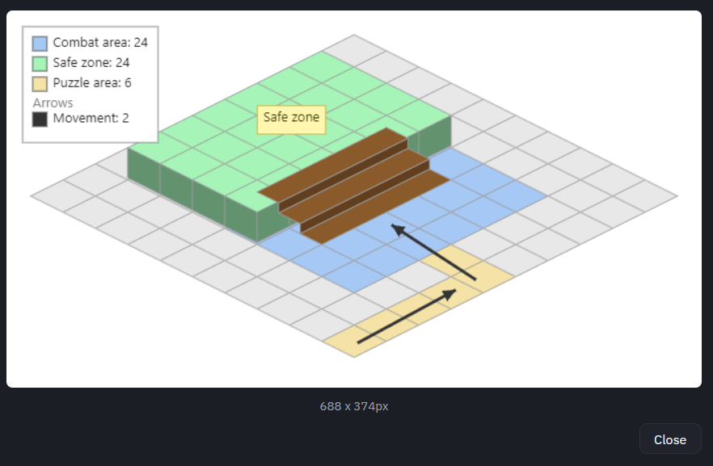

# Blockmap: iso level editor

A browser tool for sketching isometric/diametric level layouts for quest and level design docs: zones, elevation, stairs, sprites, notes, and movement arrows, all paintable on a grid. Runs entirely in the browser, nothing to install.

## Why this exists

I've been designing isometric/diametric levels for more than a couple of years now, and never quite had a tool that was comfortable to use for concepts. This tool is just that — something to help you out with drawing up a quick concept to explore your ideas.

## Opening it

You can [open it](https://laisarre.github.io/blockmap/) in your browser — there's no account, no install, no save button you have to press before you're allowed to start. Your work saves itself to the browser automatically as you go, so closing the tab by accident won't lose anything (more on that below).

## The grid and the two layers

Everything you paint lives on a grid of diamond-shaped cells. Click to paint a cell, hold the mouse button and drag to paint a whole stretch at once, right-click to erase. Pan by holding the middle mouse button and dragging; zoom with the scroll wheel, zoomed toward wherever your cursor is.

Each cell actually holds two independent colors at once:

- **Zone** — what the area is *for*: a quest area, a combat encounter, a safe zone, whatever your design needs.
- **Setting** — what it *looks* like: forest, desert, water, rock.

Switch between them with the Zone/Setting toggle at the top. Painting always affects whichever one is currently selected, so you can lay out the gameplay purpose of an area first and then go back over the same shape with its visual theme, without the two getting mixed up.

The color list for each layer is yours to change. Pick a tool with a palette (Paint or Arrow) and you'll see **Add**, **Edit**, and **Remove** underneath the swatches. Add makes a new color with its own name; Edit lets you rename a color or change it, and every cell already painted with it updates immediately; Remove clears that color from the palette and un-paints anything using it.

## Tools

The icon rail on the left switches between tools. Whichever one is active shows its own settings in the floating panel next to it.

**Paint** and **Erase** do exactly what they sound like. **Select / Move** lets you grab a placed sprite, note, arrow, or stair and drag it around — and if you click on a painted zone instead, it picks up the whole connected shape as one piece and drags that, which is handy for repositioning a room or area without repainting it cell by cell. Right-clicking something usually deletes it.

**Height Brush** raises or lowers a cell's elevation. Set a height (negative values work too) and start stamping cells — a cliff face appears automatically on whichever edges actually drop off, shaded darker than the floor so the elevation reads clearly at a glance. There's a checkbox to apply a height change to an entire connected zone in one click instead of cell by cell, which saves a lot of clicking when you're raising a whole room or platform.

**Stair** drops a ramp between two elevations. Set how wide it is, how long a run it covers, and how many height levels it climbs — length and height don't have to match, so a gentle 4-cell ramp up one level and a steep 1-cell climb up three levels both work and look the way you'd expect. The cell you click becomes the bottom of the stair; the four direction buttons just say which way it climbs from there. You can always come back and adjust any of this later by double-clicking the stair.

**Note** drops a sticky text label anywhere on the canvas — double-click one to edit it.

**Arrow** draws a directional line, for marking patrol routes, movement flow, or how areas connect to each other. Arrows have types, same idea as the zone colors: give a type a name and a color, and every arrow of that type shows up grouped together in the legend with a count. Double-click an arrow to switch it to a different type.

## Sprites

Import your own images (a tree, a chest, an NPC marker, anything) through the sprite panel on the right. Click one to select it, then click the canvas to place a copy — you can place the same sprite as many times as you like, drag any placed copy to reposition it, and drag its corner handle to resize it. Removing a sprite from the palette doesn't delete copies you've already placed.

## Saving your work

The project autosaves to the browser as you edit, so you don't lose anything if a tab closes unexpectedly. For an actual file you can keep, back up, or hand to someone else, use **Save** (or **Save As** for a new name) — it downloads a single `.json` file with everything in it, including your sprite images, so the one file is all you need. **Open** loads one back, and you can also just drag a saved `.json` onto the page instead of clicking through the file picker.

## Exporting

**Export PNG** writes out five images at once: a full render of the Zone layer and one of the Setting layer (grid, elevation, sprites, arrows, stairs, notes, and a legend), a "plain" transparent cutout of each layer with just the painted cells and no grid lines, and a standalone cutout of just your notes and arrows. The plain ones are meant to be dropped as an overlay onto something else — your own background art, a different map, whatever. Every exported image is cropped to fit whatever you actually drew, so there's no wasted blank space around a small map and nothing gets cut off on a big one.

**Export settings** controls how the legend box in these images looks — whether it shows cell counts or just names, the font sizes, and the heading text above the arrow types. **Preview** shows you the full export before you commit to actually saving the files.

## Backlog

Things I'd like to get to at some point:

- More styling options for arrows and notes
- Fixes, plus manual control over sorting order — which sprite, note, arrow, or stair sits on top when things overlap
- A smoother export flow — the options are all there, just not as easy to use as they should be yet
- A mobile-friendly version

## Changelog

**1.0** — initial release. Grid painting with two independent color layers, elevation with auto-generated cliff walls, a stair tool, sprites, notes, typed arrows, a live and exportable legend, five-file PNG export with auto-fit framing, and save/load with autosave.

## How this was built

The code in this repo was written by Claude (Anthropic's AI); I designed the tool and directed how it should work.

---

Want to run this from source or poke at the code? See [DEVELOPMENT.md](DEVELOPMENT.md).
